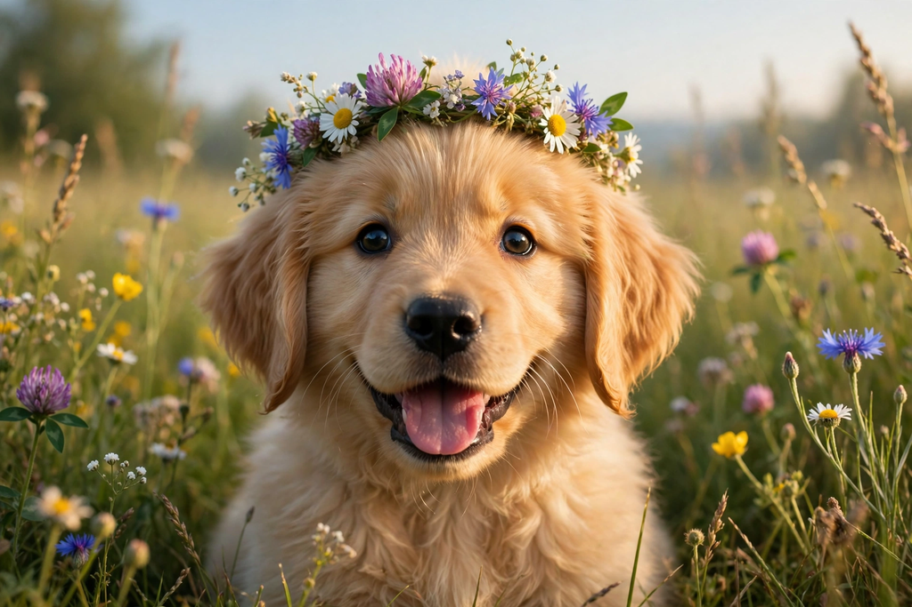

# ai-happy-01 — make.fun bounty entry

Entry for the [ai-happy-01](https://make.fun/bounty/ai-happy-01) bounty on
make.fun: a program that writes one image to `/output/entry.png`.

## The image

A fluffy golden retriever puppy wearing a small flower crown, sitting in a
wildflower meadow in warm morning sunshine — tongue out, bright sparkling
eyes, one clear happy face as the single focus. Warm palette of honey yellow,
grass green, and soft blue sky.



## How it works

`main.py` (Python 3.13, standard library only, no network) copies the
bundled asset `entry.png` byte-for-byte to `/output/entry.png`. The copy is
deterministic: two runs produce byte-identical output.

```sh
python3 main.py
```

Output: `/output/entry.png` — PNG, 1024x683 px, 956,081 bytes.

## License

MIT — see [LICENSE](LICENSE).
